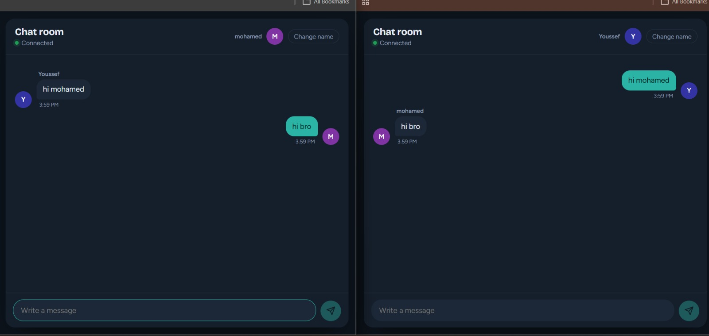
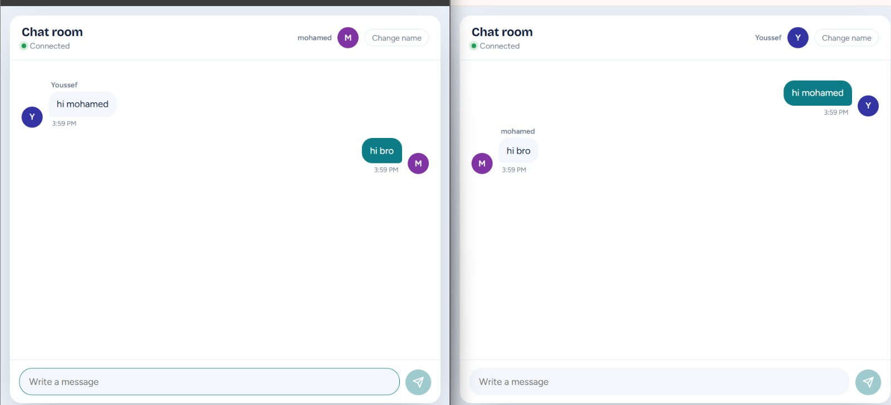

# Real-Time Chat

A real-time chat room built with **Spring Boot**, **WebSocket** and **STOMP**. Messages sent from one browser appear instantly in every other open browser, with no page refresh.



## Features

- Instant messaging between multiple users over WebSocket (STOMP over SockJS)
- Join screen to pick a display name, remembered in the browser
- Message bubbles with colored avatars, grouped by sender, with timestamps
- Live connection status and automatic reconnect if the server restarts
- Light and dark themes that follow the system setting
- Arabic and English messages, with text direction detected automatically
- Responsive layout that works on mobile



## Tech stack

| Layer | Technology |
|---|---|
| Backend | Java 17+, Spring Boot 4, Spring WebSocket, Spring Messaging (STOMP) |
| Frontend | Thymeleaf, vanilla JavaScript, SockJS, STOMP.js, plain CSS |
| Tools | Maven, Lombok |

## How it works

```
Browser                         Spring Boot
  |  connect to /ws (SockJS)         |
  |--------------------------------->|  WebSocketConfig registers the endpoint
  |  subscribe /topic/messages       |
  |--------------------------------->|  simple in-memory broker
  |  send to /app/sendMessage        |
  |--------------------------------->|  ChatController @MessageMapping
  |                                  |  @SendTo("/topic/messages")
  |<---------------------------------|  broadcast to every subscriber
```

- `WebSocketConfig` registers the `/ws` endpoint, enables a simple broker on `/topic`, and sets `/app` as the prefix for messages sent to the server.
- `ChatController` receives a `ChatMessage` on `/app/sendMessage` and broadcasts it to `/topic/messages`.
- `ChatMessage` is the model: `id`, `sender`, `content`.
- `chat.html` is the Thymeleaf page that holds the UI and the client-side JavaScript.

## Project structure

```
src/main/java/com/chatapp/chat
├── ChatApplication.java
├── config/WebSocketConfig.java
├── controller/ChatController.java
└── model/ChatMessage.java
src/main/resources/templates/chat.html
```

## Run it locally

Requirements: **JDK 17 or newer**. Maven is not needed, the wrapper is included.

```bash
git clone https://github.com/Youssefnada-Engineer/realtime-chat.git
cd realtime-chat

# Windows
.\mvnw.cmd spring-boot:run

# macOS / Linux
./mvnw spring-boot:run
```

Open <http://localhost:8080/chat>. To try it with two users, open a second window in a private/incognito tab and pick a different name.

## Current limitations

- Messages are not stored. They are only broadcast to users who are connected at that moment, and they disappear on refresh or restart.
- There is no login. Anyone with the link can join under any name.
- `setAllowedOriginPatterns("*")` is used for easy local testing and should be restricted before any real deployment.

## Ideas for next steps

- Save messages in a database and load the recent history when a user joins
- "User is typing" indicator and an online users list
- Authentication and multiple chat rooms

## What I learned

Built while following a Spring Boot and WebSocket tutorial, then extended with my own frontend and fixes. Along the way I worked with Spring's component scanning and package structure, the STOMP publish/subscribe flow, and sharing a local app with a friend through a temporary tunnel.

## Author

**Youssef Nada**, [GitHub](https://github.com/Youssefnada-Engineer)